# Bearing Fault Diagnosis Based on Improved 1D-VGG Model and t-SNE Visualization

Highlights:
1. Provides various code programs for model training, evaluation, and visualization, facilitating the porting of visualization on our own models or past models;
2. Offers an improved 1D-VGG bearing fault diagnosis model based on PyTorch, with flexible adjustment of different VGG network structures through code, making it easy for everyone to learn classic CNN architectures;
Dataset: CWRU West Reserve University bearing dataset
Environmental framework: Python 3.9, PyTorch 1.8 and above are compatible for execution
Accuracy: Test set accuracy of 96%
Output results: Training process loss and accuracy curve graphs, test set accuracy reports, confusion matrix, t-SNE visualization graphs, classification label visualization
Use cases: For papers requiring this, for graduation design requirements
Code guarantee: Code comments are detailed, ready to run without modification.
Model training process loss-accuracy graph 1:
Model training process loss-accuracy graph 2:
Fault classification in test set accuracy:
Confusion matrix:
Classification label visualization:
Original test set t-SNE visualization:
Model test set t-SNE visualization:
Preface:
This article is based on the CWRU bearing data, first preprocessed by data collection and loading into the dataset, and finally realized through PyTorch to improve the \t1D-VGG model\tfor fault data classification.
Detailed introduction to the CWRU bearing data can be found in the following article:
Python-CWRU Bearing Data Interpretation and Classification Processing
1. Bearing fault data preprocessing
\t1.1 Import data
Refer to previous articles for the preprocessing of fault classification in 10 categories, including the CWRU bearing data 10 category dataset:
1. Datasets:
Training set, validation set, and test set are divided according to the ratio of 7:2:1 for training, validation, and testing respectively, and data is finally saved.
The above figure shows the format of data reading and preprocessing ideas.
1.2 Data Preprocessing, Creating a dataset.
2. Improving 1D-VGG for bearing fault diagnosis based on Pytorch
2.1 Define the 1D-VGG classification network model
2.2 Set parameters and train the model
50 epochs, accuracy rate of 96%, the improved 1D-VGG network significantly improves classification effect. The model can fully extract global spatial and local features of bearing fault signals, converges quickly, has excellent performance, high accuracy, and significant effects!
Provide detailed code documentation explanation:
Previously interesting content:
Python-Case Western Reserve University (CWRU) bearing data interpretation and classification processing
Python bearing fault diagnosis (I) Short-time Fourier Transform STFT
Python bearing fault diagnosis (II) Continuous Wavelet Transform CWT
Python bearing fault diagnosis (III) Empirical Mode Decomposition EMD
Pytorch-LSTM bearing fault one-dimensional signal classification (I)
Pytorch-CNN bearing fault one-dimensional signal classification (II)
Pytorch-Transformer bearing fault one-dimensional signal classification (III)
Python bearing fault diagnosis (IV) Based on EMD-CNN fault classification
Python bearing fault diagnosis (V) Based on EMD-LSTM fault classification
Python bearing fault diagnosis (VI) Based on EMD-Transformer fault classification
Python bearing fault diagnosis (VII) Based on EMD-CNN-LSTM fault classification
Python bearing fault diagnosis (VIII) Based on EMD-CNN-GRU parallel model fault classification
1. FFT + CNN - BiGRU-Attention: A model for bearing fault identification based on temporal and frequency domain feature attention fusion
2. FFT + CNN - Transformer: A model for bearing fault identification based on temporal and frequency domain feature fusion
3. Python Bearing Fault Diagnosis (9) Based on VMD+CNN-BiLSTM for Fault Classification
4. Python Bearing Fault Diagnosis (10) Based on VMD+CNN-Transformer for Fault Classification
5. Python Bearing Fault Diagnosis (11) Based on VMD+CNN-BiGRU-Attention for Fault Classification
6. Cross Attention Fusion of Temporal and Frequency Domain Features in an FFT + CNN - BiLSTM-CrossAttention Bearing Fault Identification Model
7. Cross Attention Fusion of Temporal and Frequency Domain Features in an FFT + CNN-Transformer-CrossAttention Bearing Fault Identification Model
8. Python Bearing Fault Diagnosis Tutorial
9. Python Bearing Fault Diagnosis (13) Super-strong Machine Learning Recognition Model Based on Fault Signal Feature Extraction
10. Python Bearing Fault Diagnosis (14) Highly Innovative Fault Recognition Model
11. Python Bearing Fault Diagnosis (15) One-Dimensional Fault Signal Recognition Model Based on CNN-Transformer
12. Python Bearing Fault Diagnosis (16) Highly Innovative Fault Recognition Model (II)
| SciCit 1 Region, Highly Innovative Bearing Fault Diagnosis Model!
13. Python Bearing Fault Diagnosis (18) Innovative Diagnosis Model Based on CNN-TCN-Attention
14. Genetic Algorithm + Swin-CNN-GAM: A Highly Innovative Bearing Fault Diagnosis Model
15. Attention Magic Modified | Super-strong Bearing Fault Diagnosis Model!
16. Bearing Fault - Cross Attention Innovation Model Family Set
Python Bearing Fault Diagnosis (19) - Innovative Diagnosis Model Based on Transformer-BiLSTM
END
2. Friends who like this can click to follow, give the article a "like", share in WeChat groups or discuss in groups.

## Images

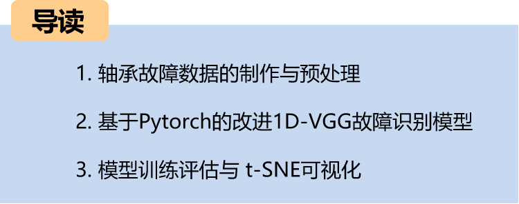
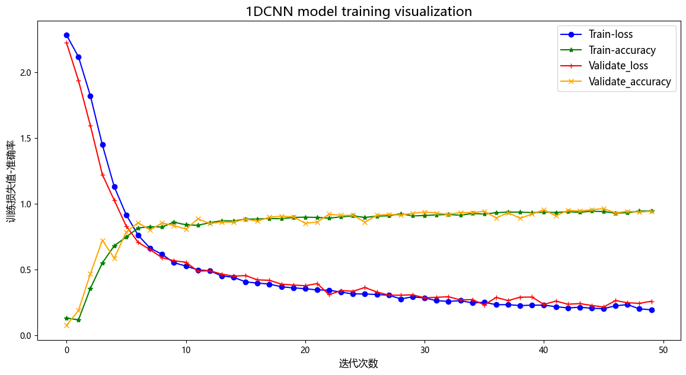
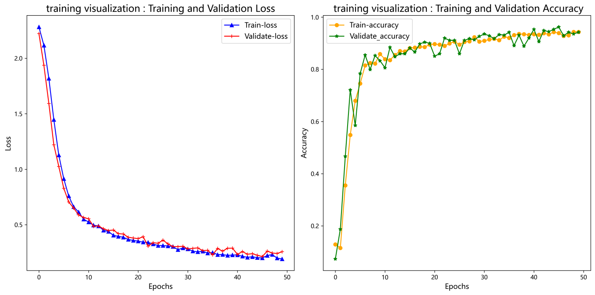
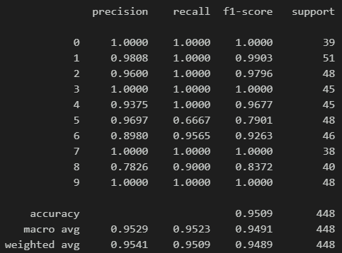
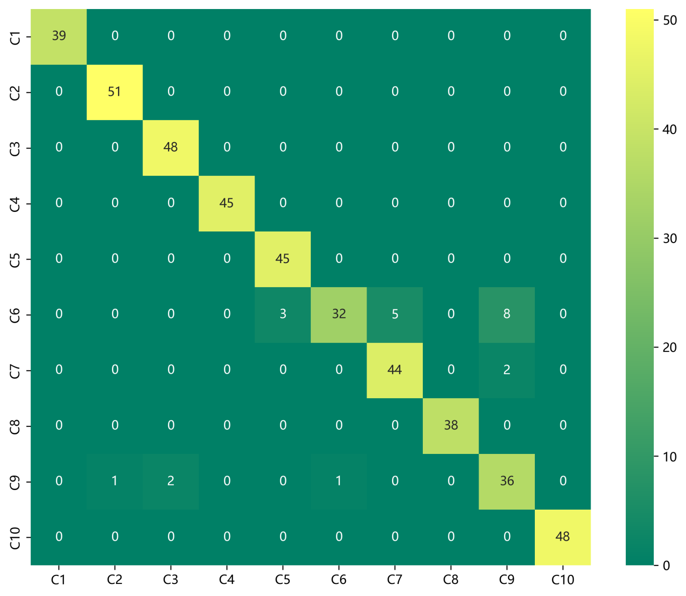
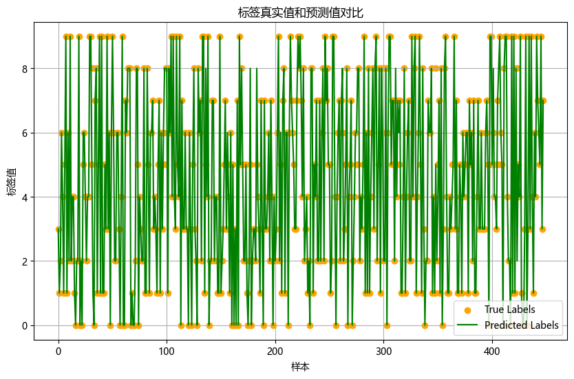
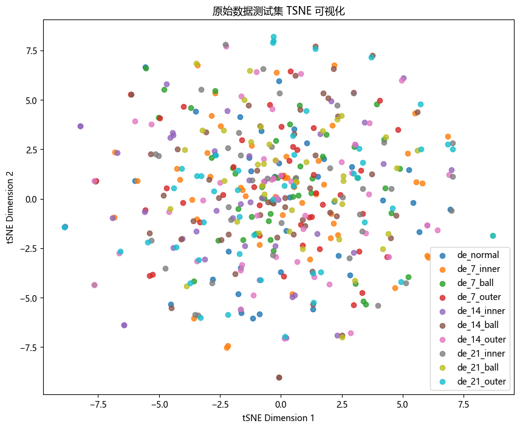
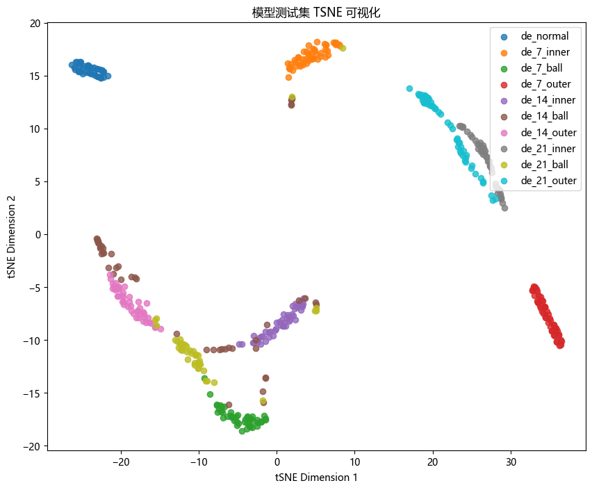
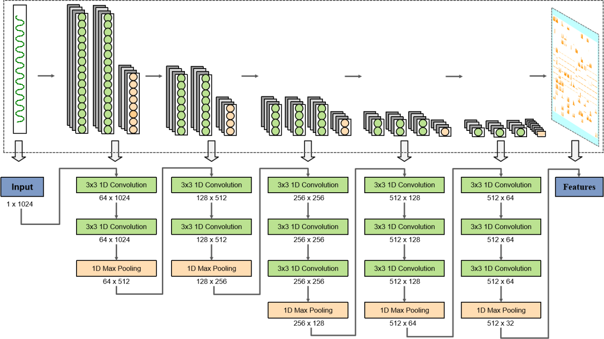

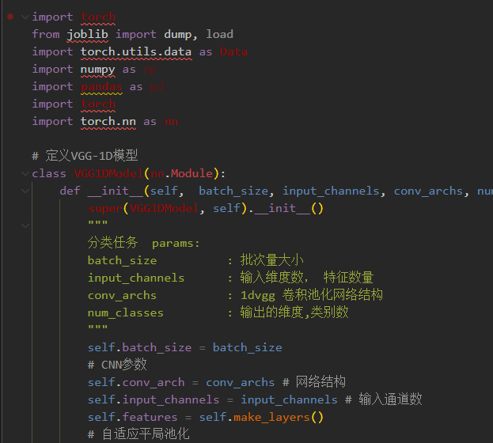

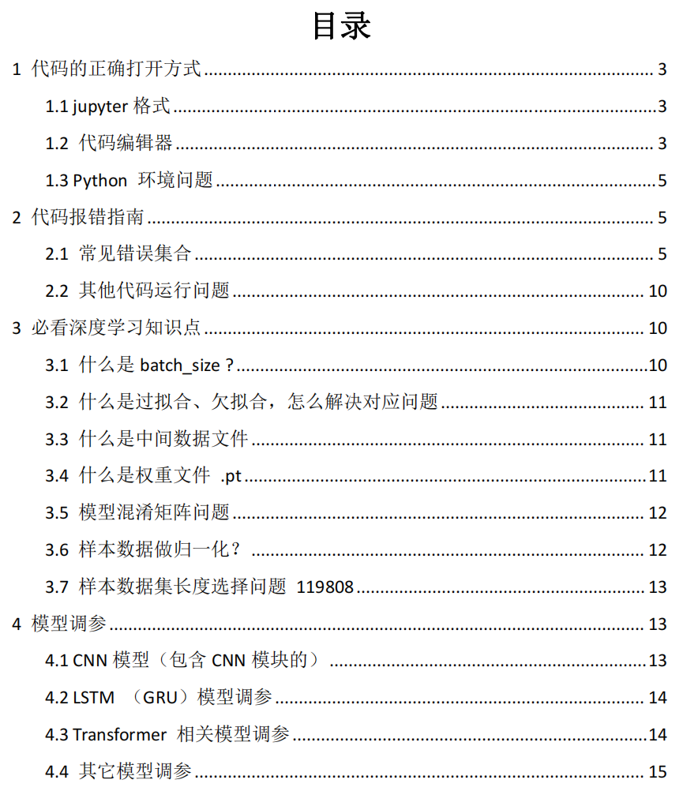
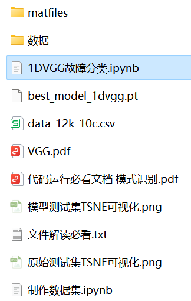

<!-- PAYMENT_BLOCK -->

## Get this dataset

- Payment link (Stripe): [Buy now](https://buy.stripe.com/3cs8yP7sY87d0vu9AB)
- Payment QR code: 

<!-- /PAYMENT_BLOCK -->
